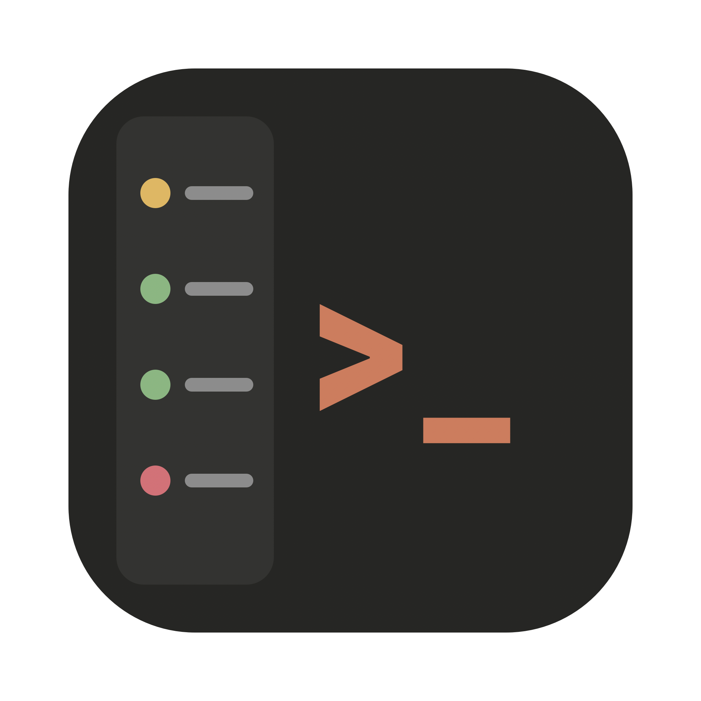
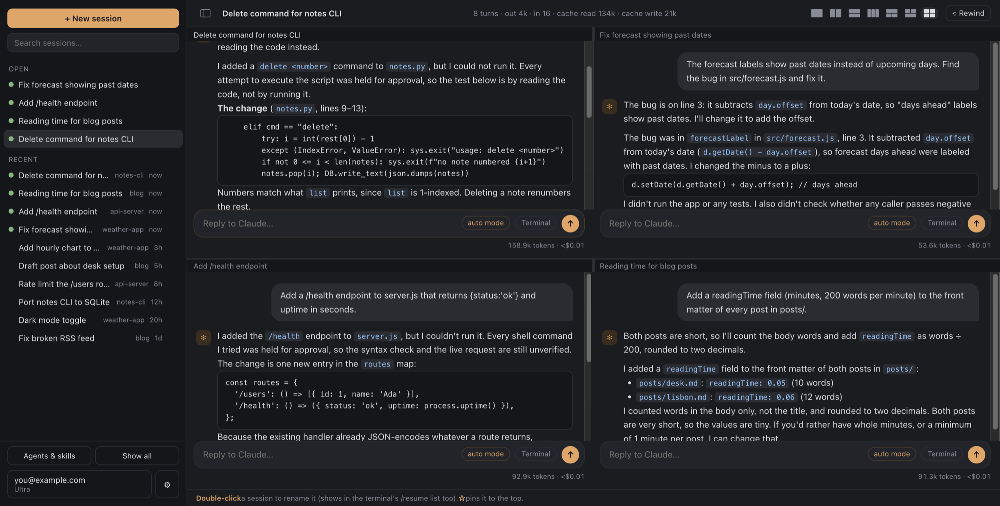

<p align="center"></p>

# CC Desk

A small macOS window for [Claude Code](https://docs.claude.com/en/docs/claude-code) that feels like a chat app: your sessions in a sidebar, each one shown as a chat, with the **real `claude` terminal** running underneath (⌘T flips between them).



> Unofficial. Not made by, affiliated with, or endorsed by Anthropic. "Claude" and "Claude Code" are Anthropic's trademarks.

It doesn't replace or modify Claude Code. It runs your installed `claude` in an embedded terminal, so your settings, hooks, skills, plugins and MCP servers all work exactly as they do in Terminal.

## What you get
- **Sessions sidebar**: every past session under its real title, search, pins, rename (shows in `/resume` too), click to resume. Scripted runs (`claude -p`) stay out of the list.
- **Chat view:** each session reads as messages (code blocks, lists, tables), with a reply box, a live "working" line with Stop, the current mode, and Claude's questions and permission prompts as buttons. ⌘T (or the Terminal pill) shows the real terminal; menus that need it open there.
- **Images in the terminal:** pasted and opened images show as small thumbnails on their line; click to enlarge.
- **Several sessions open at once**, with live status: a pulsing red dot while Claude works, a flashing white dot and title when it needs you, a plain dot when it's finished
- **Mac notifications** when a session finishes or needs you; click to jump there
- **Settings window** (⌘,) for model, effort, permissions, theme, notifications, plugins, connections (`claude mcp list`)
- **Sessions that survive quitting:** a small background helper holds them, so quit or update the app and they keep working, then reconnect when you reopen it. You choose in Settings whether quitting asks first. Sessions untouched for 24 hours stop on their own; their chats stay saved.
- **Split view:** as many sessions on screen as you like. Start from a preset (side by side, stacked, three columns, one across the top or bottom, 2×2), then split any pane right (⌘D) or down (⇧⌘D) from its name strip, drag a pane's name strip or an Open tab from the sidebar onto another pane (middle swaps, an edge puts it beside), and drag any divider: it only resizes the panes either side. The layout is remembered across restarts.
- **Hide the sidebar** (button or ⌘B) so split panes get the full width; also remembered.
- **Continue on your phone:** every session starts with Claude Code's `--remote-control`, so you can pick it up in the Claude phone app or at claude.ai/code.
- **Phone alerts (optional):** when Claude has waited over 90 seconds for an answer or permission, even with the app closed, using the free ntfy app.
- **Usage page** in Settings: estimated cost, input, output and cached tokens by session, day, hour and model.
- **Per-session usage** (turns and tokens), a ⟲ Rewind button, drag files onto a session, an account menu
- **Updates in the app**: an "Update available" line shows up when there's a new version
- **Shortcuts:** ⌘, Settings · ⌘B sidebar · ⌘T chat/terminal · ⌘D / ⇧⌘D split right/down · ⌘A selects the whole prompt (then Backspace or typing replaces it)
- Opens filling the screen (minus the menu bar and Dock)

## Support
CC Desk is free, with nothing locked or required. If it saves you time, you can [buy me a coffee on Ko-fi](https://ko-fi.com/ralski) ♥

## Install
Needs macOS, [Node.js](https://nodejs.org) 20+, Claude Code (logged in) and Apple's command line tools (`xcode-select --install`).

```bash
git clone https://github.com/RAFA3LSKI/cc-desk.git ~/cc-desk
cd ~/cc-desk && ./install.sh
```
Then open **CC Desk** from Spotlight (⌘ Space). Updates: click **Install & restart** when the app offers one, or run `./install.sh --update`.

## Privacy
Everything stays on your Mac. CC Desk sends nothing anywhere: no analytics, no server. It reads Claude Code's local files (`~/.claude/projects`, `~/.claude/sessions`), and it writes only:
- the rename line that Claude Code's own `/rename` writes,
- the settings you change in its Settings window, in `~/.claude/settings.json` (backed up first; every other key is left alone),
- its own preferences, in `~/.claude-desk.json`,
- a cache of token counts for the Usage page, in `~/.claude-desk-usage.json`,
- the background helper's socket and log, `~/.claude-desk-ptyd.sock` and `.log`.

CC Desk's own network traffic is only `git fetch` against this repo, to check for updates, and, only if you turn on phone alerts, a short message ("Claude needs you" plus the session name) sent through the public [ntfy.sh](https://ntfy.sh) server to your private random channel. Installing an update runs the new version's code on your Mac (like any app update), so only install updates from this repo. Claude Code itself talks to Anthropic as usual, and because sessions start with `--remote-control`, they're reachable from your own Claude account on the phone app and claude.ai/code.

## How it works
Electron + [xterm.js](https://xtermjs.org) + [node-pty](https://github.com/microsoft/node-pty). `sessions.js` reads the session files, `settings.js` edits a whitelist of settings, `main.js` runs `claude` in a pseudo-terminal, `index.html` is the UI. Live status comes from the `~/.claude/sessions/<pid>.json` files Claude Code writes (an approach borrowed from [Nimbalyst](https://github.com/nimbalyst/nimbalyst)).

`ptyd.js` is the background helper that keeps sessions alive; `usage.js` builds the Usage page.

Checks (all run hidden, in a sandbox HOME, and never touch your real files or the running app):
- `node check.js`: session parsing
- `DESK_SMOKE=1 ~/Applications/"CC Desk.app"/Contents/MacOS/Electron`: hidden UI load
- `DESK_SELFTEST=1 node_modules/.bin/electron selftest.js`: a real `claude` boots in a hidden tab
- `node uitest.js` and `node uitest-advanced.js`: everyday and advanced clicks with visible-state checks
- `node uitest-persist.js`: quit and reopen, sessions survive and replay
- `DESK_SELFTEST=1 node_modules/.bin/electron chattest.js`: a real `claude` answers through the chat box

## License
MIT
